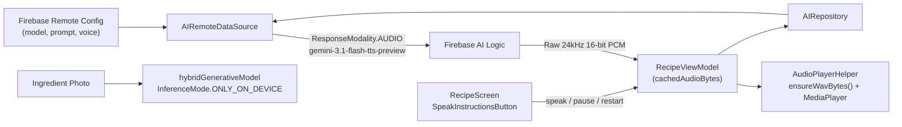

# FriendlyMeals – Firebase Android Samples (ADS '26 Showcase Fork)

[](https://firebase.google.com/docs/ai-assistance/agent-skills)
[](https://firebase.google.com/docs/ai-assistance/agent-skills)

Welcome to **FriendlyMeals**, an Android sample demonstrating end-to-end **Firebase AI Logic**, **Hybrid On-Device Inference**, **Firestore Enterprise**, **Remote Config**, **Cloud Storage**, and **Firebase App Check** in Jetpack Compose.

> [!IMPORTANT]
> **Fork Highlights (`kroikie/FriendlyMeals-Android`)**: This fork extends [`FirebaseExtended/FriendlyMeals-Android`](https://github.com/FirebaseExtended/FriendlyMeals-Android) with features built and demonstrated for **Android Developer Summit (ADS '26)** — including **hands-free Recipe Instructions Text-to-Speech (TTS)** with raw PCM-to-WAV synthesis and playback controls, **strict on-device Gemini Nano inference (`ONLY_ON_DEVICE`)**, unit tests, and declarative **Firestore & Cloud Storage Security Rules**.

## 🤖 Built with Gemini & Firebase Agent Skills

The ADS '26 enhancements in this fork were built with **Gemini** as the AI coding agent, equipped with **[Firebase Agent Skills](https://firebase.google.com/docs/ai-assistance/agent-skills)** (`firebase-ai-logic`, `firebase-remote-config-basics`, `firebase-firestore`, and `firebase-security-rules-auditor`) to ground code generation in current Firebase SDK patterns, multimodal `ResponseModality.AUDIO` APIs, and production Security Rules best practices.

👉 **Learn how to install and use Firebase Agent Skills in your coding agent:**  
**[https://firebase.google.com/docs/ai-assistance/agent-skills](https://firebase.google.com/docs/ai-assistance/agent-skills)**


---

## ✨ What's New in This Fork (ADS '26 Updates)

| Capability | Upstream (`FirebaseExtended`) | This Fork (`kroikie`) | Key Files |
| :--- | :--- | :--- | :--- |
| **Recipe Instructions TTS** | Static Markdown instructions only (TTS only on wine pairing button) | Hands-free **Speak / Pause / Play / Restart / Retry** audio controls directly on the **Instructions** card, powered by `gemini-3.1-flash-tts-preview` (`Puck` voice) + Remote Config | [`AIRemoteDataSource.kt`](app/src/main/java/com/google/firebase/example/friendlymeals/data/datasource/AIRemoteDataSource.kt), [`RecipeScreen.kt`](app/src/main/java/com/google/firebase/example/friendlymeals/ui/recipe/RecipeScreen.kt), [`RecipeViewModel.kt`](app/src/main/java/com/google/firebase/example/friendlymeals/ui/recipe/RecipeViewModel.kt) |
| **PCM-to-WAV Audio Engine & Caching** | One-shot `AudioTrack` buffer for pairing clip | Hilt-injected [`AudioPlayerHelper`](app/src/main/java/com/google/firebase/example/friendlymeals/ui/shared/AudioPlayerHelper.kt) with **44-byte RIFF/WAVE header synthesis** over 24 kHz 16-bit mono PCM, `MediaPlayer` seek/restart, lifecycle cleanup, and in-memory byte caching | [`AudioPlayerHelper.kt`](app/src/main/java/com/google/firebase/example/friendlymeals/ui/shared/AudioPlayerHelper.kt), [`RecipeViewState.kt`](app/src/main/java/com/google/firebase/example/friendlymeals/ui/recipe/RecipeViewState.kt) |
| **Strict On-Device Inference** | `InferenceMode.PREFER_IN_CLOUD` | **`InferenceMode.ONLY_ON_DEVICE`** for zero-cost, offline ingredient extraction from camera photos on **Gemini Nano** | [`AIRemoteDataSource.kt`](app/src/main/java/com/google/firebase/example/friendlymeals/data/datasource/AIRemoteDataSource.kt) |
| **Declarative Security Rules & Unit Tests** | Console-only setup, no local unit tests for audio | Versioned [`firestore.rules`](firestore.rules), [`storage.rules`](storage.rules) (5 MB `image/*` enforcement + default-deny), [`firebase.json`](firebase.json), and JUnit tests verifying WAV byte layout & UI state transitions | [`AudioPlayerHelperTest.kt`](app/src/test/java/com/google/firebase/example/friendlymeals/AudioPlayerHelperTest.kt), [`RecipeViewStateTest.kt`](app/src/test/java/com/google/firebase/example/friendlymeals/RecipeViewStateTest.kt), [`storage.rules`](storage.rules) |

### Architecture of the ADS '26 Additions



### Deep Dive into Local Changes

#### 1. Hands-Free Recipe Instructions Text-to-Speech (`gemini-3.1-flash-tts-preview`)
Cooks often have messy hands mid-recipe and need step-by-step instructions read aloud with full transport controls (pause, resume, and restart from the beginning without re-billing Gemini):
- **Remote Config–Driven Speech Generation** ([`AIRemoteDataSource.kt`](app/src/main/java/com/google/firebase/example/friendlymeals/data/datasource/AIRemoteDataSource.kt) & [`remote_config_defaults.xml`](app/src/main/res/xml/remote_config_defaults.xml)):
  Configures `ResponseModality.AUDIO` and `SpeechConfig(voice = Voice(voiceName))` dynamically from Remote Config (`recipe_tts_model_name`, `recipe_tts_prompt`, `recipe_tts_voice`, defaulting to `gemini-3.1-flash-tts-preview` and `Puck`).
  ```kotlin
  val ttsModel = aiModel.generativeModel(
      modelName = modelName,
      generationConfig = generationConfig {
          responseModalities = listOf(ResponseModality.AUDIO)
          speechConfig = SpeechConfig(voice = Voice(voiceName))
      }
  )
  ```
- **RIFF/WAVE Header Synthesis & Playback** ([`AudioPlayerHelper.kt`](app/src/main/java/com/google/firebase/example/friendlymeals/ui/shared/AudioPlayerHelper.kt)):
  Gemini TTS returns raw 24 kHz, 16-bit mono little-endian PCM bytes (`InlineDataPart`). `AudioPlayerHelper.ensureWavBytes()` inspects incoming audio and prepends a compliant 44-byte RIFF/WAVE header when needed so Android's `MediaPlayer` (`CONTENT_TYPE_SPEECH`) can pause, resume, and `seekTo(0)` cleanly.
- **Cached Playback State Machine & Compose Controls** ([`RecipeViewModel.kt`](app/src/main/java/com/google/firebase/example/friendlymeals/ui/recipe/RecipeViewModel.kt), [`RecipeViewState.kt`](app/src/main/java/com/google/firebase/example/friendlymeals/ui/recipe/RecipeViewState.kt), [`RecipeScreen.kt`](app/src/main/java/com/google/firebase/example/friendlymeals/ui/recipe/RecipeScreen.kt)):
  Models `AudioState` (`IDLE` → `GENERATING` → `PLAYING` ⇄ `PAUSED` / `READY` / `ERROR`), caches synthesized audio bytes in memory (`cachedInstructionsAudioBytes`) to eliminate redundant API calls on replay, coordinates with the wine-pairing player so two audio streams never overlap, and stops playback automatically via Compose `DisposableEffect` when leaving the screen.

#### 2. Strict On-Device Multimodal Inference (`InferenceMode.ONLY_ON_DEVICE`)
- In [`AIRemoteDataSource.kt`](app/src/main/java/com/google/firebase/example/friendlymeals/data/datasource/AIRemoteDataSource.kt), `hybridGenerativeModel` is configured with **`OnDeviceConfig(mode = InferenceMode.ONLY_ON_DEVICE)`**:
  ```kotlin
  private val hybridGenerativeModel = aiModel.generativeModel(
      modelName = remoteConfig.getString(HYBRID_CLOUD_MODEL_KEY),
      onDeviceConfig = OnDeviceConfig(mode = InferenceMode.ONLY_ON_DEVICE)
  )
  ```
  Combined with `loadOnDeviceModel()` (`checkStatus()` / `download()`) and Firebase Performance Monitoring custom traces (`hybrid-inference` with `inferenceSource` attribution), ingredient detection runs strictly on-device with **Gemini Nano**—delivering zero cloud token cost and offline capability.

#### 3. Security Hardening & Automated Unit Tests
- **Firebase Security Rules**: Includes [`firestore.rules`](firestore.rules), [`storage.rules`](storage.rules) (restricting `/images/{imageId}` uploads to authenticated users, `image/*` MIME types, and `< 5 MB` payloads with a default-deny catch-all), and [`firebase.json`](firebase.json).
- **Unit Tests**: Run `./gradlew testDebugUnitTest` to execute [`AudioPlayerHelperTest.kt`](app/src/test/java/com/google/firebase/example/friendlymeals/AudioPlayerHelperTest.kt) (validating RIFF/WAVE magic bytes, little-endian sample/byte rates, channel/bit-depth fields, and WAV idempotence) and [`RecipeViewStateTest.kt`](app/src/test/java/com/google/firebase/example/friendlymeals/RecipeViewStateTest.kt).

---

## 📺 Video Series

- [Firebase Fundamentals on YouTube](https://www.youtube.com/playlist?list=PLl-K7zZEsYLnfwBe4WgEw9ao0J0N1LYDR)

## 🚀 Core Features

- **Firebase AI Logic**: Multimodal recipe generation, recipe photo synthesis, live cooking assistant (Gemini Live API), wine pairing TTS, **hands-free recipe instructions TTS**, and **on-device Gemini Nano ingredient extraction**.
- **Firestore Enterprise edition**: Store recipes, likes, reviews, and grocery lists in Firestore Enterprise edition and build Pipeline queries.
- **Firebase Authentication**: Anonymous & authenticated user protection for reviews, favorites, and uploads.
- **Cloud Storage**: Store AI-generated and scanned meal images in Cloud Storage, protected by size- and MIME-validated Security Rules.
- **Remote Config**: Dynamically update Gemini model names, voice profiles, and TTS prompts without shipping an app update.
- **App Check**: Protect Firebase resources and AI endpoints from abuse using Play Integrity (release) and DebugAppCheckProvider (debug).

## 🛠️ Getting Started

1. **Clone this repository**
   ```sh
   git clone https://github.com/kroikie/FriendlyMeals-Android.git
   ```
2. **Open the project**
   - Open `FriendlyMeals-Android` in Android Studio.

## 🔥 Setting Up Firebase

1. **Create a Firebase Project**
   - Sign into the [Firebase console](https://console.firebase.google.com/).
   - Click the button to create a new Firebase project, and follow the on-screen workflow.
   - Enable the products listed in the 'Core Features' section by navigating to the corresponding area of the console.

2. **Register the Android App**
   - Click **Add app** > **Android**.
   - Enter the package name: `com.google.firebase.example.friendlymeals`
   - Click **Register app**.

3. **Download `google-services.json`**
   - Move `google-services.json` into `FriendlyMeals-Android/app/` (gitignored by default).
   - If you didn't download this file during registration, you can [obtain it later](https://support.google.com/firebase/answer/7015592).

4. **Enable Firebase services in the Firebase console**
   - [**Firebase Authentication**](https://console.firebase.google.com/project/_/authentication/?useAutoProject=true): Enable the service and turn on the **Anonymous** sign-in provider.
   - [**Firestore**](https://console.firebase.google.com/project/_/firestore/?useAutoProject=true): Enable **Firestore Enterprise edition** (`default` database) and deploy [`firestore.rules`](firestore.rules).
   - [**Firebase AI Logic**](https://console.firebase.google.com/project/_/ailogic/?useAutoProject=true): Enable the **Gemini Developer API**.
   - [**App Check**](https://console.firebase.google.com/project/_/appcheck/?useAutoProject=true): Register your Android app using the **Play Integrity** provider (with your signing certificate's SHA-256 fingerprint).
   - [**Remote Config**](https://console.firebase.google.com/project/_/config/?useAutoProject=true): Enable Remote Config (in-app defaults are preconfigured in [`remote_config_defaults.xml`](app/src/main/res/xml/remote_config_defaults.xml), including `recipe_tts_model_name`, `recipe_tts_prompt`, and `recipe_tts_voice`).
   - [**Firebase Storage**](https://console.firebase.google.com/project/_/storage/?useAutoProject=true): Enable Cloud Storage (Blaze plan required) and deploy [`storage.rules`](storage.rules).

5. **Create Firebase AI Logic Server Prompt Templates**
   - Visit the [AI Logic > Prompt templates tab](https://console.firebase.google.com/project/_/ailogic/templates/?useAutoProject=true) (see [Server Prompt Templates docs](https://firebase.google.com/docs/ai-logic/server-prompt-templates/get-started)).
   - Create templates corresponding to the files in the [`prompts/`](prompts) folder and test them in the console.

6. **Run the app & register your App Check debug token**
   - Build and run in Android Studio on an Android emulator or physical device (use a Gemini Nano–capable Pixel device to test `InferenceMode.ONLY_ON_DEVICE`).
   - Copy the `DebugAppCheckProvider` secret printed in Logcat and add it under **App Check > Apps > Manage debug tokens** in the Firebase Console:
     ```text
     DebugAppCheckProvider: Enter this debug secret into the allow list
     in the Firebase Console for your project: 123a4567-b89c-12d3-e456-789012345678
     ```

## 🧪 Running Tests

```sh
./gradlew testDebugUnitTest
```

## 📄 License

This project is licensed under the [Apache License 2.0](https://www.apache.org/licenses/LICENSE-2.0). Based on [`FirebaseExtended/FriendlyMeals-Android`](https://github.com/FirebaseExtended/FriendlyMeals-Android).
